# Soft-Start Speed Controller for a 90 V DC Motor Using a Buck Converter

*English summary of the original report "Control de Motores Eléctricos: Controlador de Velocidad" (Spanish), Universidad Panamericana, Guadalajara, September 27, 2024. Group project (three authors). Full report (Spanish):

> **Note on this summary.** It is a condensed translation of the report, plus a theoretical loss estimate that was **not** part of the original report. Where I corrected an equation from the original report, it is marked **(corrected)**.

**My role:** PCB design in KiCad, fabrication of the board on the university's CNC machine, and soldering/assembly. Teammates handled firmware, the tachometer and the controller design. The passive components and the single-layer FR4 board were purchased; the IR2184 driver and the two MOSFETs were provided by a professor.

## 1. Goal

Design and build a speed controller for a permanent-magnet DC motor with a **soft start**. The goal is to limit inrush current and voltage spikes in the armature circuit at turn-on, which protects both the motor and the electronics. A buck converter regulates the armature voltage. It starts from a low voltage and ramps up to nominal, and a feedback loop keeps the speed constant when the mechanical load changes.

## 2. System overview

```
127 V AC mains → 2:1 transformer → full-bridge rectifier + filter capacitors (~90 V DC)
   → synchronous buck stage, two MOSFETs (IR2184 driver, 20 kHz PWM) → LC filter → DC motor
                         ↑ PWM                                      │
                      ESP32  ←  optocoupler tachometer  ←───────────┘
```

## 3. Motor

| Parameter | Value |
|---|---|
| Model | 113 PMDC 90-1/2-1750 (permanent magnet) |
| Power | 1/2 HP |
| Rated speed | 1750 RPM |
| Rated voltage | 90 V DC |
| Rated armature current | 5.0 A |
| Armature inductance | 8.11 mH |
| Brushes | 2 carbon |
| Form factor / duty | 1.3 / continuous |
| Enclosure / insulation | TEFC / Class F |
| Max ambient | 40 °C |

**Characterization.** The motor was characterized by measuring supply current and speed at different supply voltages. `[Insert table and plots: current vs. voltage, speed vs. voltage]`

## 4. Rectifier (AC to DC)

- A single **KBPC3504** bridge module (35 A, 400 V PIV) replaces four discrete diodes, with a filter capacitor bank on the DC bus (2 × 1000 µF / 250 V).
- For a full-wave rectifier, the average output voltage with no filter is **V_avg = 2·V_peak/π** **(corrected)**. With a filter capacitor, the output approaches V_peak.
- Power balance: **P_in = P_out + P_losses** **(corrected)**.
- The rectifier and buck stage were designed and simulated together in MATLAB/Simulink.

## 5. Buck converter

**Topology and operation.** A **synchronous** buck converter: two MOSFETs in a half-bridge, with the low-side MOSFET replacing the freewheeling diode, and an LC output filter. In continuous conduction:

- Output voltage: **V_out = D · V_in**
- Inductor current ripple: **ΔI_L = V_out · (1 − D) / (L · f_s)** **(corrected)**
- Power balance: **V_in · I_in = V_out · I_out + P_losses**

**Design choices.**

- Switching frequency: **20 kHz**
- Power stage: **2 × IRFP250** MOSFETs, driven by an **IR2184** half-bridge gate driver through a **10 Ω gate resistor on each MOSFET**. The **1N4937** fast-recovery diode and a **330 µF** capacitor form the bootstrap circuit for the high-side gate drive
- Control and logic: **ESP32** generating the PWM; a **15 V** supply for the driver and an **L7805CV** regulator giving **5 V** for the logic
- Inductor: about **3.3 mH** (from memory), rewound by hand from a salvaged inductor using wire rated for 5 A, because commercial parts for this power level were too expensive
- Output filtering: 330 µF / 63 V electrolytic
- Input capacitors: 2 × 1000 µF / 250 V
- Heat sinks on the MOSFETs

**Control.** A feedback loop measures speed with an optocoupler tachometer and adjusts the PWM duty cycle to hold the reference speed set by a 10 kΩ potentiometer. Several control strategies were tested, including a PID controller and Mamdani fuzzy control. `[Add which controllers were compared and how, if you want.]`

## 6. Build process

1. **Simulation** in MATLAB/Simulink (rectifier and buck together).
2. **Schematic** in KiCad (power stage, driver, regulator).
3. **Prototype on two perfboards** to check the design. Checked with an oscilloscope.
4. **First PCB** (in-house milling). The drill and cutter were too wide for the pad spacing, which warped the board and left too little room for soldering.
5. **Second PCB** with wider hole spacing and room for MOSFET heat sinks. Components moved over from the prototype, and the two small control-side capacitors (100 µF and 10 µF) were replaced by two 330 µF / 63 V capacitors.

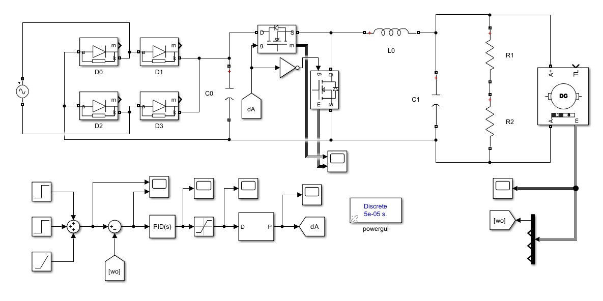

*figure 1: Simulink Implementation of the design*

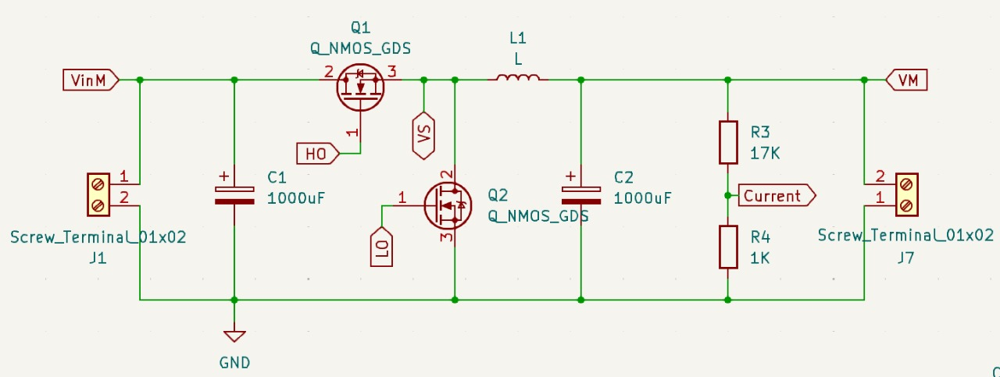

*figure 2: KiCad Schematic of the Buck Converter*

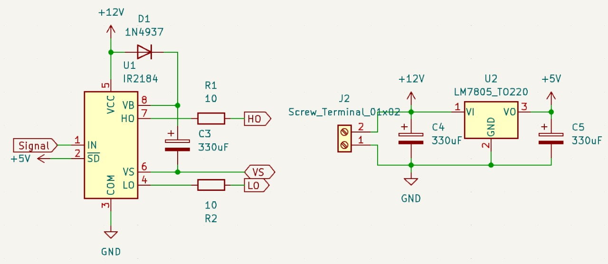

*figure 3: KiCad Schematic of the driver*

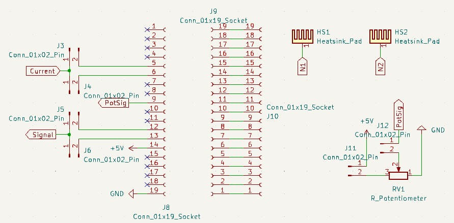

*figure 4: KiCad Schematic for the ESP32 socket*

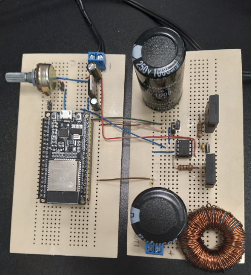

*figure 5: Perfboard prototype*

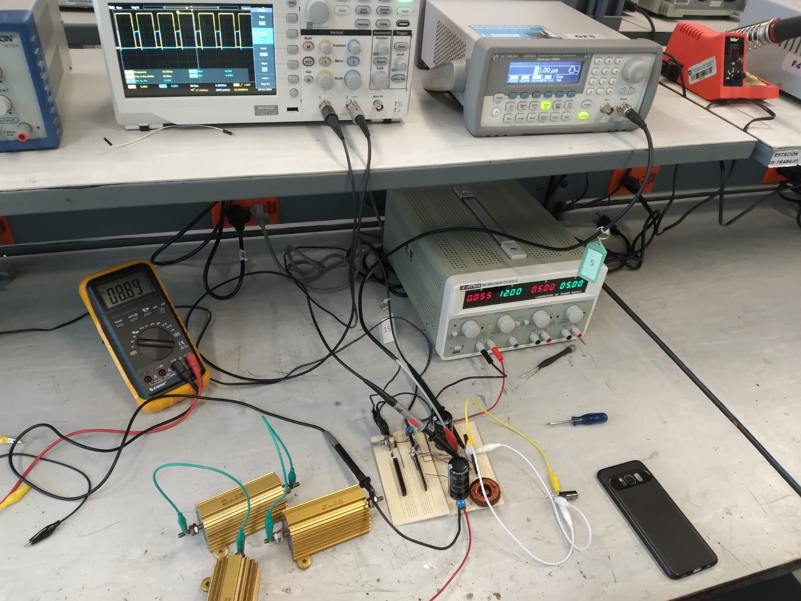

*figure 6: Perfboard Testing*

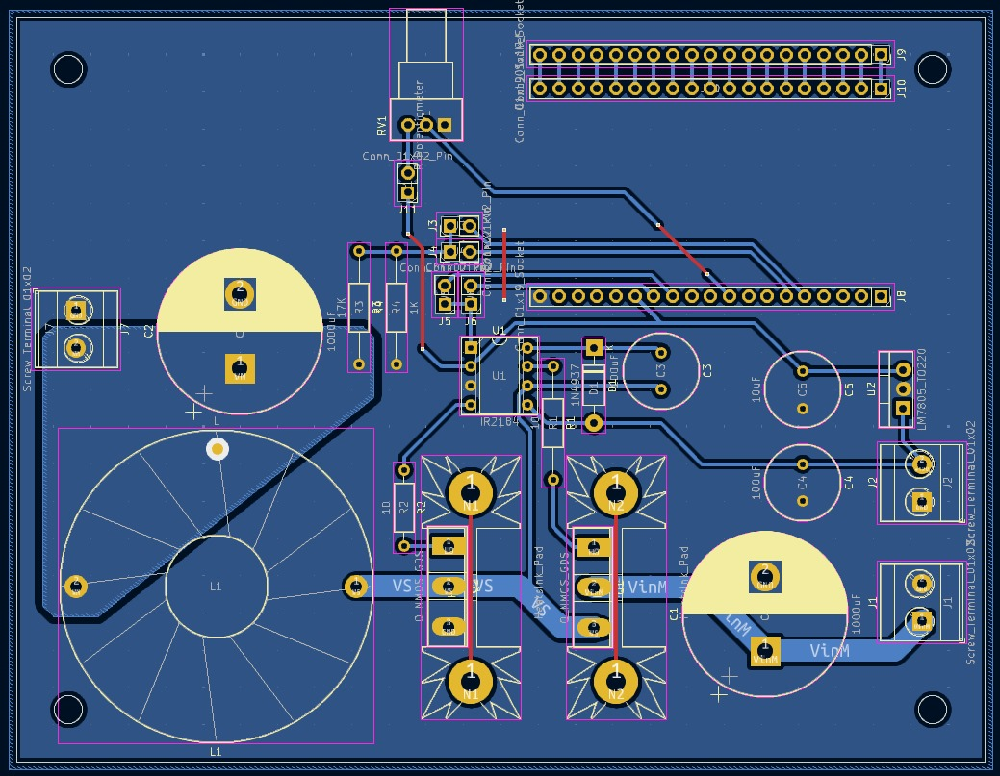

*figure 7: Original KiCad design, was scraped because it was too wide for the CNC machine*

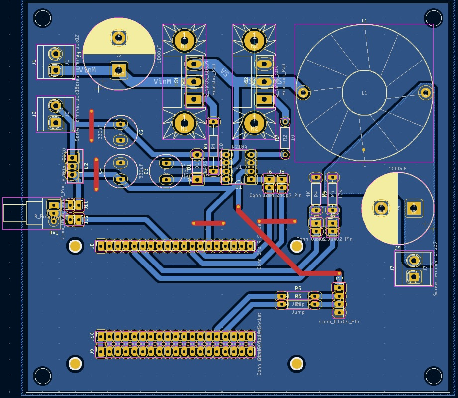

*figure 8: Revision 2 of the board, narrower than the original*

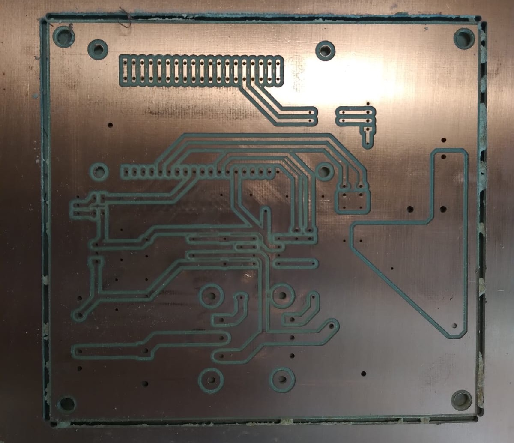

*figure 9: Machined board*

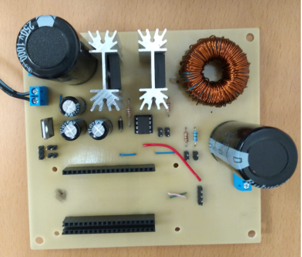

*figure 10, machined and assembled board*

## 7. Results

- The PWM stage was verified on an oscilloscope with a 20 kHz signal at two different duty cycles. 
- The final board **ran the motor and controlled its speed as intended.**
- Qualitative load test: when the optocoupler tachometer disc was held back by hand, the controller raised the output voltage to recover speed.
- Not measured in this project: efficiency, quantitative step response. 

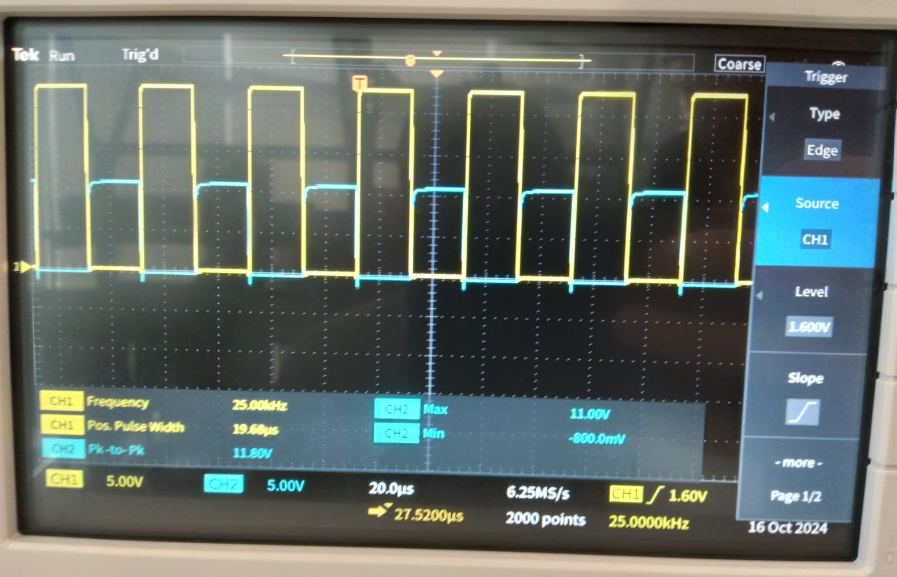

*figure x: 20kHz signal from low and high side outputs of the driver*

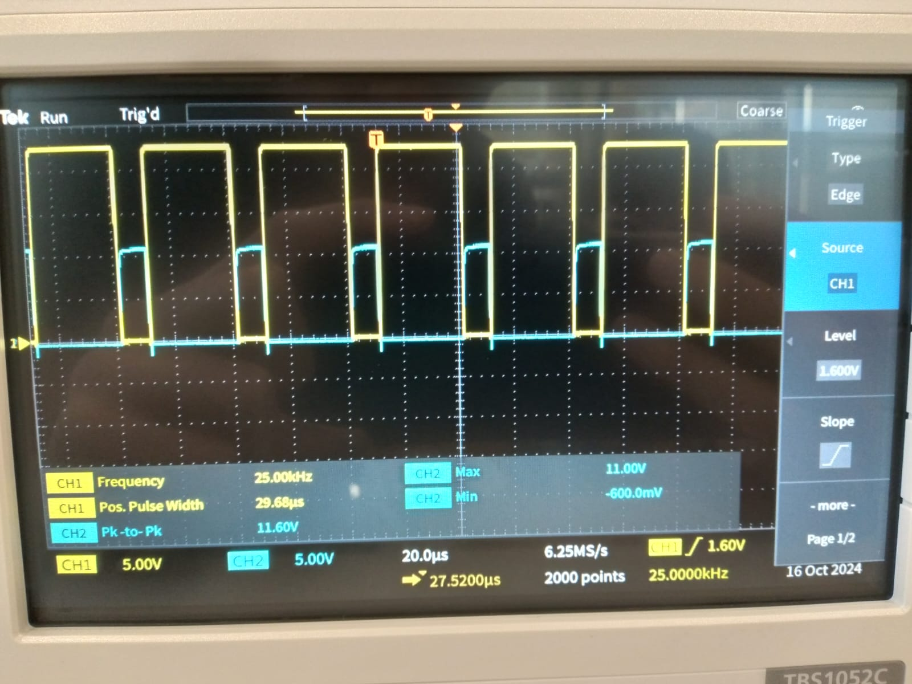

*figure x: 20kHz signal with a different duty cicle*
## 8. Theoretical switching and conduction losses (not in the original report)

This is a first-order estimate at the motor's rated operating point. It is not a measurement.

**Assumptions**

| Item | Value | Source |
|---|---|---|
| Input voltage | 90 V DC | Report (nominal motor voltage) |
| Load current | 5 A | Motor rated armature current |
| Switching frequency | 20 kHz | Report |
| Gate resistor | 10 Ω per MOSFET | Report figures |
| Gate drive | 15 V; driver peak current about 1.4 A source / 1.8 A sink, so about 8 to 11 Ω of effective output resistance | IR2184 datasheet (from memory; verify) |
| R_DS(on) | 0.085 Ω at 25 °C | Vishay IRFP250 datasheet, V_GS = 10 V |
| Q_g, Q_gd | 140 nC max, 74 nC (at V_DS = 160 V; assume 50 to 74 nC at 90 V) | Vishay IRFP250 datasheet |
| C_oss | 780 pF (V_DS = 25 V; lower at 90 V, so conservative) | Vishay IRFP250 datasheet |
| Gate plateau voltage | about 5 V | Assumed |

**Why the switching time is not just the driver's.** The driver's datasheet rise and fall times are measured into a small test capacitance, not into a power MOSFET gate. In the real circuit, the time the MOSFET spends with voltage and current overlapping is set by how fast the gate charge is moved, which depends on the driver, your gate resistor and the MOSFET's gate charge together. The key step is the Miller plateau, where t ≈ Q_gd / I_gate.

- **Turn-on.** Gate current ≈ (15 V − 5 V) / (10 Ω + about 10 Ω) ≈ 0.5 A. Voltage fall: 50 to 74 nC / 0.5 A ≈ 100 to 150 ns. Adding about 40 ns for the current rise gives about 140 to 190 ns.
- **Turn-off.** Gate current ≈ 5 V / (10 Ω + about 8 Ω) ≈ 0.28 A. Voltage rise: 50 to 74 nC / 0.28 A ≈ 180 to 265 ns. Adding about 100 ns for the current fall gives about 280 to 370 ns.
- **Total overlap ≈ 420 to 560 ns**, against the 148 ns in the datasheet. The datasheet time was measured with a 6.2 Ω gate resistor, so it is a lower bound for this circuit.

**High-side switching loss**

P_sw ≈ ½ · V_in · I_o · (t_overlap) · f_s ≈ 0.5 × 90 V × 5 A × (420 to 560 ns) × 20 kHz ≈ **1.9 to 2.5 W**

Using the datasheet time alone would give only 0.67 W, which understates the loss in this circuit.

**Other terms**

| Loss | Formula | Estimate |
|---|---|---|
| Conduction, both MOSFETs | I² · R_DS(on) (the duty cycles add up to 1) | ≈ 2.1 W at 25 °C; roughly 3.6 W hot (R_DS(on) up about 1.7×) |
| Output capacitance, per MOSFET | ½ · C_oss · V_in² · f_s | ≈ 0.06 W |
| Gate drive, per MOSFET | Q_g · V_gs · f_s | ≈ 0.04 W |
| Dead-time body-diode conduction | ≈ V_f · I_o · 2 · t_dead · f_s | ≈ 0.1 W, assuming V_f about 1.2 V and t_dead about 0.5 µs (check your firmware and the IR2184 datasheet) |
| Low-side switching | switches with near-zero voltage across it | negligible |
| Body-diode reverse recovery | ≈ V_in · Q_rr · f_s | Up to ≈ 3.4 W using Q_rr = 1.89 µC (Fairchild IRFP250 datasheet, at dI_F/dt = 100 A/µs). That figure is for the datasheet's test current, which is higher than 5 A, so the real loss is probably well below it. A rough range is 0.5 to 3.4 W `[check the datasheet's test current]` |

**Current ripple.** At D = 0.5 (V_out = 45 V), ΔI ≈ 45 × 0.5 / (3.3 mH × 20 kHz) ≈ **0.34 A** peak-to-peak for the filter inductor alone. It is lower if the motor's 8.11 mH armature inductance is also in the current path.

**Takeaway.** Without reverse recovery, MOSFET losses add up to roughly 4.5 to 6.5 W. Including the reverse-recovery range above, the total is about **5 to 10 W**, or roughly 1.4 to 2.7% of the 370 W of mechanical output (1/2 HP). Switching loss is comparable to conduction loss here, mainly because the 10 Ω gate resistors and the driver's limited current slow the edges. The current in the circuit rises at roughly 100 A/µs at turn-on (about 5 A in 40 to 50 ns), which is close to the datasheet's Q_rr test condition. Inductor, rectifier and wiring losses are not included.

## 9. What I would change in a second revision

- **Professionally fabricated, two-layer PCB with solder mask.** The board was milled on a CNC and soldered by hand, so it is single-layer and has no solder mask.
- **Remove the 2:1 transformer** and redesign for a DC bus of about 180 V (rectified mains directly).
- **Safe programming and updates.** Either add galvanic isolation or let the ESP32 update wirelessly. During development we constantly risked damaging our computers' USB ports.
- **Enclosure and better connectors.**
- **Add the planned display** and the **planned output voltage and current sensors**, which would enable other control strategies such as current limiting.

## 10. Bill of materials (main parts)

KBPC3504 bridge rectifier · 2 × IRFP250 MOSFET · IR2184 gate driver · 1N4937 fast diode (bootstrap) · L7805CV regulator · ESP32 module · ferrite core and copper wire (inductor) · electrolytic capacitors (330 µF / 63 V; 2 × 1000 µF / 250 V) · 10 Ω resistors · 10 kΩ potentiometer · optocoupler tachometer · heat sinks · screw terminals, headers, perfboards, and a custom PCB.

## References

- Richtek Technology Corporation, *Current Ripple Factor of a Buck Converter* (application note AN009).
- Vishay, *IRFP250* power MOSFET datasheet.
